# Self-Healing Kubernetes Platform: GitOps · SLOs · Observability

**A production-style Kubernetes platform where the cluster heals the app, Git is the single source of truth, and reliability is measured with SLOs, not guessed.**

Mission 2 of my self-healing series. [Mission 1](https://github.com/Gokul36115/self-healing-java-app-aws) made a single **server** heal itself on AWS. This project does the same at **platform** level: Kubernetes restarts, reschedules and scales the service, Argo CD keeps the cluster matching Git, and Prometheus + Grafana measure whether users actually notice failures.

---

## Highlights
- **Self-healing on three levels:** container restarts (liveness probes), traffic shielding (readiness probes), and configuration drift correction (Argo CD `selfHeal`).
- **GitOps delivery:** GitHub Actions tests, builds and pushes the image; a reviewed `release.sh` step updates the tag in Git, and Argo CD deploys it. No `kubectl apply` by hand.
- **Zero-downtime rollouts:** `maxUnavailable: 0`, readiness gates, graceful shutdown and a PodDisruptionBudget.
- **Autoscaling:** a HorizontalPodAutoscaler scales 2 → 5 pods on CPU, with a scale-down stabilization window.
- **SLO-based alerting:** a 99.5% availability SLO with multi-window **error-budget burn-rate alerts** (Google SRE workbook style), plus self-healing alerts (restarts, crash loops, heap pressure).
- **Hardened pods:** non-root user, read-only root filesystem, all Linux capabilities dropped, seccomp `RuntimeDefault`.
- **Everything as code:** Helm chart, Argo CD applications, Prometheus rules and the Grafana dashboard all live in this repo.

## Architecture
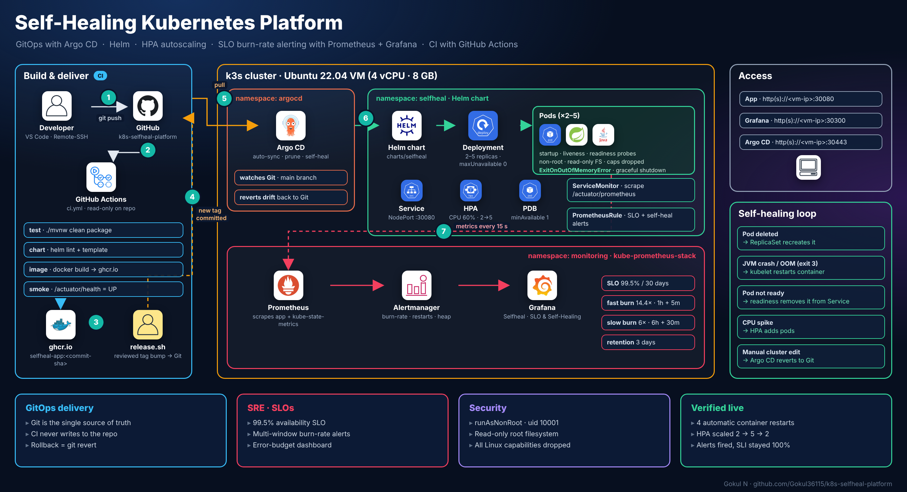

**Flow:** ① push → ② CI tests, lints the chart and builds the image → ③ image pushed to ghcr.io → ④ a reviewed `release.sh` commits the new tag → ⑤ Argo CD pulls Git → ⑥ Helm renders the app → ⑦ Prometheus scrapes metrics, Alertmanager evaluates SLO alerts, Grafana shows them.

## Tech stack
| Area | Tools |
|---|---|
| Kubernetes | k3s, Deployments, Services, HPA, PodDisruptionBudget, probes |
| Packaging | Helm |
| GitOps / CD | Argo CD (automated sync, prune, self-heal) |
| CI | GitHub Actions, GitHub Container Registry (ghcr.io) |
| Observability | Prometheus, Grafana, Alertmanager, kube-state-metrics (kube-prometheus-stack) |
| Application | Java 17, Spring Boot, Actuator, Micrometer |

## Project structure

```text
.
├── app/                         Spring Boot service (chaos endpoints + /api/cpu load endpoint)
├── charts/selfheal/             Helm chart
│   ├── templates/
│   │   ├── deployment.yaml      probes, rolling update, security context
│   │   ├── service.yaml
│   │   ├── hpa.yaml             CPU autoscaling 2→5
│   │   ├── pdb.yaml             keep ≥1 pod during disruptions
│   │   ├── servicemonitor.yaml  tells Prometheus what to scrape
│   │   ├── prometheusrule.yaml  SLIs, SLO burn-rate + self-healing alerts
│   │   └── dashboard.yaml       Grafana dashboard as a ConfigMap
│   └── dashboards/selfheal.json
├── gitops/                      Argo CD applications + monitoring stack values
├── scripts/
│   ├── bootstrap.sh             one command: k3s → image → Argo CD → GitOps apps
│   ├── chaos.sh                 break things on purpose and watch them heal
│   ├── load.sh                  generate load to trigger autoscaling
│   └── release.sh               promote a CI-built image via Git (reviewed GitOps release)
├── docs/
│   ├── architecture.png
│   ├── errors.md                real problems, root causes, fixes
│   └── screenshots/             evidence from the live run
└── .github/workflows/ci.yml     test → lint → build → push → smoke test (read-only on the repo)
```

## How it heals

| Failure | What happens | Mechanism |
|---|---|---|
| Pod deleted | Replaced in seconds; the other replica keeps serving | Deployment + ReplicaSet |
| JVM crash (`/api/crash`) | Container restarted | Process exit → kubelet restart |
| OutOfMemoryError (`/api/memory`) | JVM exits (code 3), container restarted | `ExitOnOutOfMemoryError` + restart policy |
| JVM hung / unhealthy | Restarted after 3 failed checks | Liveness probe |
| Pod not ready yet | Removed from load balancing, not restarted | Readiness probe |
| CPU spike | Extra pods added, removed when load drops | HorizontalPodAutoscaler |
| Someone edits the cluster by hand | Reverted to what Git says | Argo CD self-heal |

## SLOs and alerts
- **SLI:** share of HTTP requests that are not 5xx.
- **SLO:** 99.5% over 30 days (error budget 0.5%).
- **Fast-burn alert:** error rate > 14.4× budget over both 1 h and 5 m (budget gone in ~2 days).
- **Slow-burn alert:** > 6× budget over both 6 h and 30 m.
- **Self-healing alerts:** pod restarted, crash-looping, JVM heap > 90%, no ready pods.

## Run it

Requirements: Ubuntu VM with 4 CPUs, 8 GB RAM, 20 GB free disk, Docker, git.

```bash
git clone https://github.com/Gokul36115/<this-repo>.git && cd <this-repo>
./scripts/bootstrap.sh        # ~10 minutes on first run
./scripts/chaos.sh            # break it, watch it heal
./scripts/load.sh             # load it, watch it scale
```

| Endpoint | URL |
|---|---|
| App | `http://<vm-ip>:30080` |
| Grafana | `http://<vm-ip>:30300` (dashboard "Selfheal · SLO & Self-Healing") |
| Argo CD | `https://<vm-ip>:30443` |

## Results (live run)

### Platform up
| Cluster: every pod Running across 4 namespaces | App resources: Deployment 2/2, HPA 2–5, PDB, NodePort |
|---|---|
| 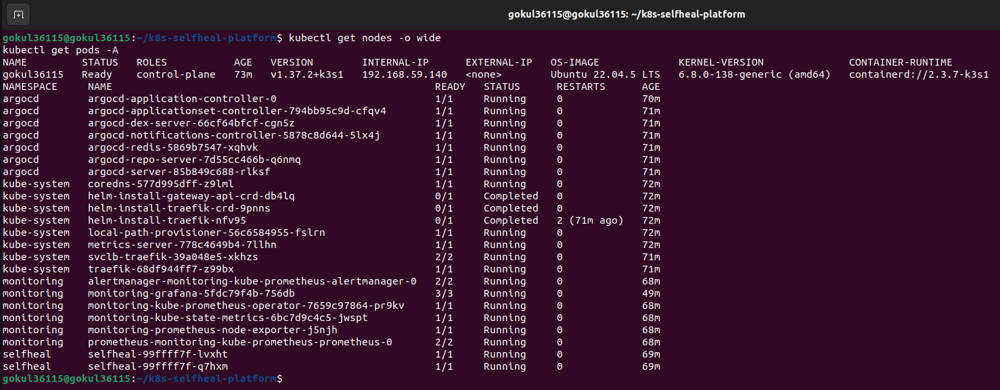 | 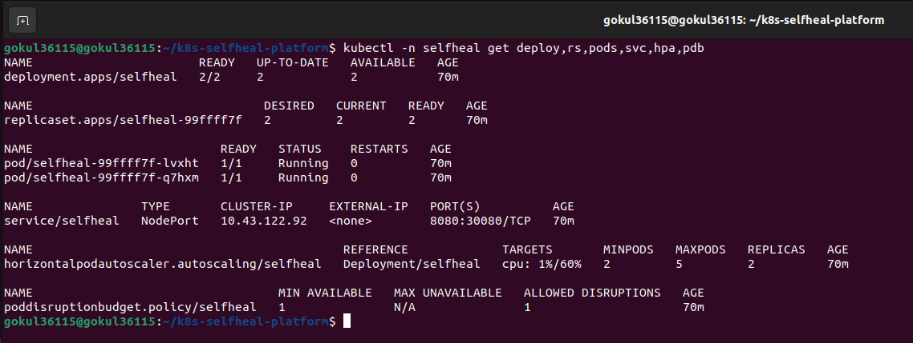 |

### GitOps: Argo CD deploys from Git
Both applications **Healthy + Synced**. The resource tree shows everything the Helm chart created; the header shows the deployed commit and its author.

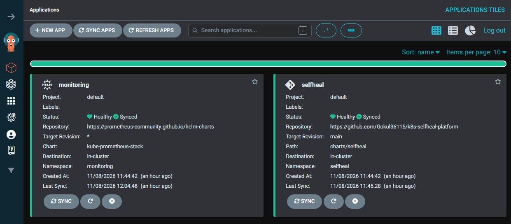
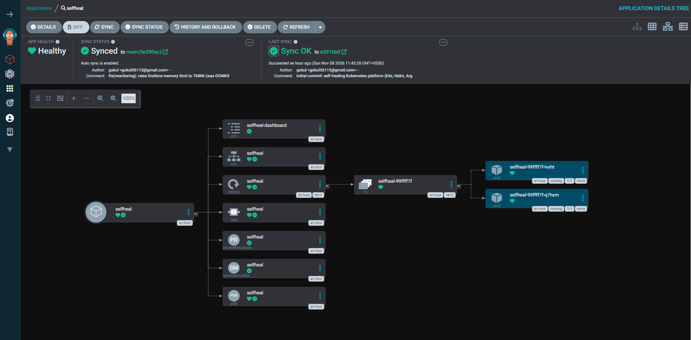

### CI: test → chart → image (read-only on the repo)
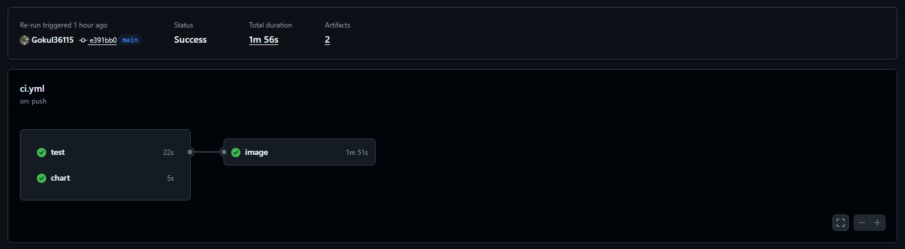
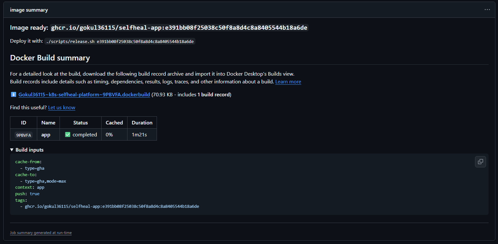

### Self-healing under chaos
Baseline: 100% availability, 2 ready pods, 0 restarts, 0 alerts.
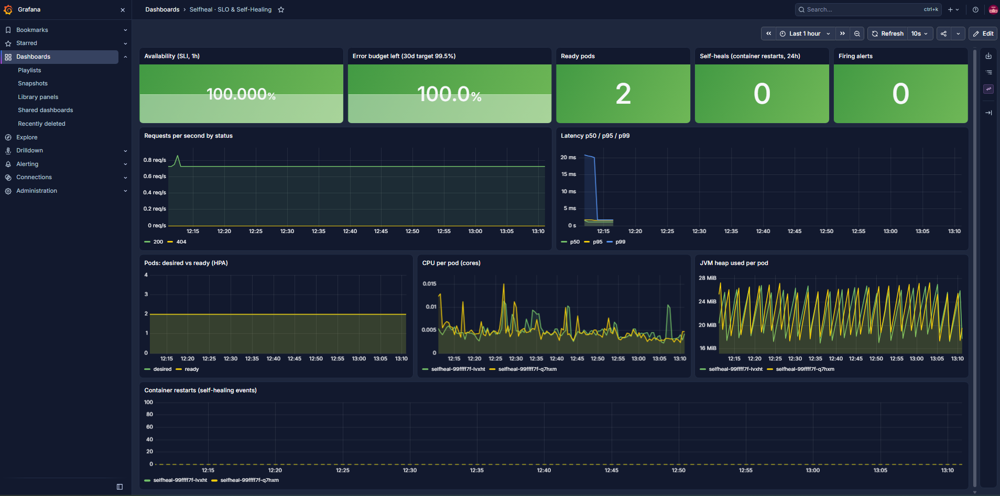

Then I deleted pods, crashed the JVM (`/api/crash`) and forced `OutOfMemoryError`s (`/api/memory`, JVM exits with code 3):

| Moment | Ready pods | Self-heals (restarts) | Firing alerts | What happened |
|---|---|---|---|---|
| Baseline | 2 | 0 | 0 | Healthy |
| First crash | 2 | 1 | 0 | Container restarted automatically |
| JVM restarts | 4 | 3 | 2 | Start-up CPU spike made the HPA scale **2 → 5** |
| Peak of chaos | 1 | 4 | 3 | Restart alerts firing; one replica kept serving |
| Recovered | 2 | 4 | 3 | Back to 2 pods, no manual action |

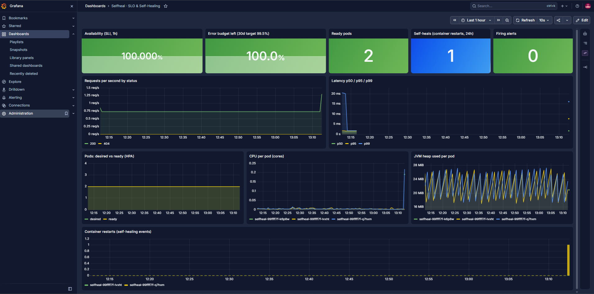
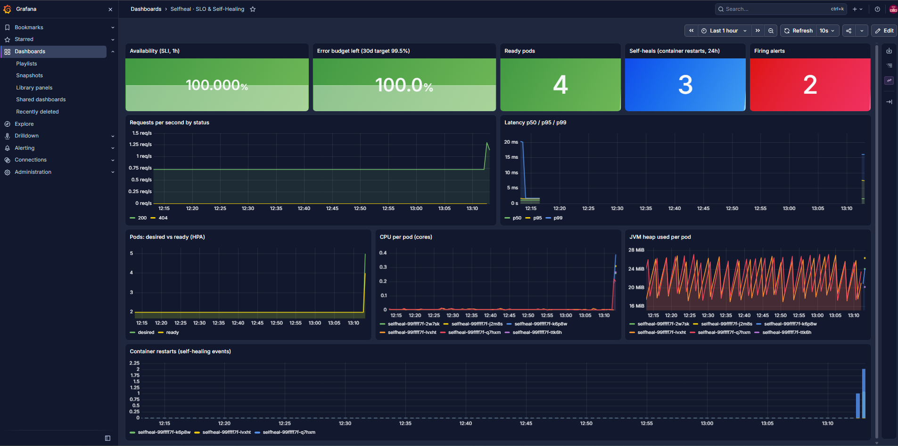
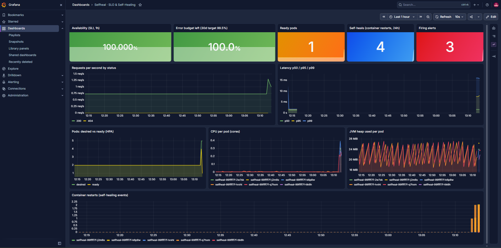
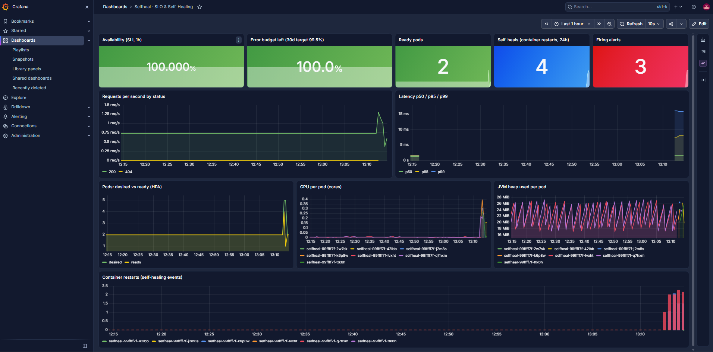

**Takeaways**
- Every failure was recovered by Kubernetes with **zero manual steps**, and the restart alerts fired as designed.
- The availability SLI stayed at 100% because it counts **HTTP 5xx from the app**. Requests that hit a crashing pod fail at the connection level, which the app can't see, so `scripts/chaos.sh` measures availability from the client side as well.
- The unexpected HPA scale-out during JVM restarts is documented in [docs/errors.md](docs/errors.md#5-observation-hpa-scaled-out-during-chaos-testing-without-real-load).

## Problems faced and fixes
Real issues, with root cause and fix, are in [docs/errors.md](docs/errors.md):
- VM too small → resized and grew the disk online (`growpart` + `resize2fs`)
- `permission_denied: write_package` on ghcr.io → per-package Actions access
- Grafana `CrashLoopBackOff` → `OOMKilled (137)` → limit raised **through a Git commit** (GitOps)
- CI made read-only (`contents: read`) so promotion is a reviewed human step
- HPA scaling on JVM start-up CPU (observation and tuning options)

## Roadmap
- [ ] Phase 2: Ingress with automatic TLS (cert-manager) and SSO login (OIDC via Keycloak) for Grafana and Argo CD
- [ ] Alertmanager e-mail notifications
- [ ] Deploy the same platform to AWS EKS with Terraform

## Author
**Gokul N** · Middleware Engineer (IBM WebSphere, Liberty, IHS, Okta SSO, SSL/TLS) · AWS · DevOps · SRE
GitHub: [Gokul36115](https://github.com/Gokul36115)
